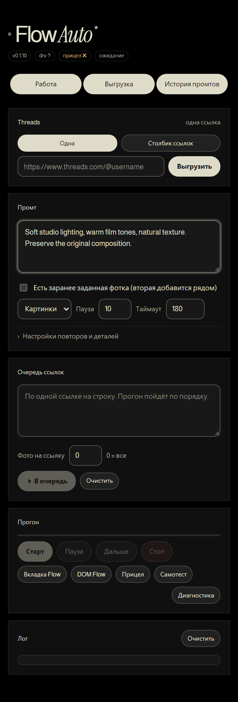

# Flow Auto

[](https://github.com/sorayamka/flow-auto/actions/workflows/checks.yml)


A Chrome extension with a side-panel workspace for collecting Threads images,
selecting references, and running image/video workflows in Google Flow.

**Collect references. Shape a prompt. Run the workflow from one workspace.**



> Personal project · JavaScript · Chrome Extension APIs · Playwright

The interface uses a warm, cream-on-black theme with locally bundled Almarai
and Instrument Serif fonts. Russian text uses the system fallback because
Almarai does not include Cyrillic glyphs.

## Features

- Single-link and bulk Threads image collection.
- Selectable image gallery and optional base reference image.
- Sequential workflows with pause, resume, stop, and retry controls.
- Upload-only mode for manually continuing work in Flow.
- Prompt history, persisted settings, progress reporting, and diagnostic tools.

## Install locally

1. Download or clone this repository.
2. Open `chrome://extensions` and enable **Developer mode**.
3. Choose **Load unpacked** and select the directory containing `manifest.json`.
4. Open Google Flow, sign in, and open the extension side panel.
5. Paste a Threads source URL and collect images. Select images, enter a prompt,
   review the settings, then start the workflow.

Chrome 116 or newer is required by the manifest. The background worker can be
suspended by Chrome; workflow recovery depends on saved extension state.

## Development

The extension runs directly from plain HTML, CSS, and JavaScript. No production
build or React runtime is required.

```sh
npm ci
npx playwright install chromium
npm run check
npm run format:check
npm test
```

Use a current Node.js LTS release. Tests use a mocked Chrome runtime and local
fixture images. They do not send requests to Threads or start Flow generations.

## Structure

```text
background/sw.js            State, messaging, queues, downloads, recovery
content/flow-driver.js     Flow page integration
content/threads-fallback.js Threads page extraction fallback
lib/threads.js             Threads parsing helpers
sidepanel/panel.html       Panel markup
sidepanel/panel.js         Panel interaction and rendering
sidepanel/base.css         Layout and runtime state styles
sidepanel/prisma.css       Warm visual theme
sidepanel/fonts/           Bundled fonts
tests/                    Panel regression tests
```

## Permissions and local data

| Permission              | Purpose                                                     |
| ----------------------- | ----------------------------------------------------------- |
| `sidePanel`             | Display the workspace                                       |
| `storage`               | Save workflow state and prompt history                      |
| `tabs`, `scripting`     | Communicate with supported open pages                       |
| `downloads`             | Save results and explicitly requested diagnostics           |
| `declarativeNetRequest` | Configure supported network requests                        |
| `debugger`              | Browser input dispatch and requested diagnostic screenshots |

Host access is restricted to the domains listed in `manifest.json`. The
debugger permission is powerful and Chrome displays a browser-level notice
when a debugger session is attached.

Sources, prompts, workflow state, and history are stored locally in the browser.
Diagnostics can include page contents and screenshots. Review diagnostic files
before sharing them or attaching them to public issues.

## Verification and known limitations

- Automated tests cover panel state transitions, gallery visibility, selection,
  disconnected runtime errors, queue progress, and responsive tab layouts.
- Threads and Flow are external services. Page changes, account sessions,
  rate limits, and expired media URLs can interrupt a workflow.
- Persisted media URLs can stop working. Collect images again to obtain fresh
  URLs; hiding an orphaned gallery does not renew expired media.
- A live acceptance run is still required for scraping, real uploads,
  generation, downloads, calibration, and browser-session recovery.
- No claim of affiliation with Google or Meta is made.

## Contributing

For bug reports, include Chrome version, extension version, steps to reproduce,
and the expected result. Remove personal prompts, media URLs, and account data
from logs before attaching them. Run the checks above before submitting changes.

The project does not yet declare an open-source license. Confirm ownership and
choose a license before inviting reuse. Bundled third-party fonts retain their
own upstream license terms.
